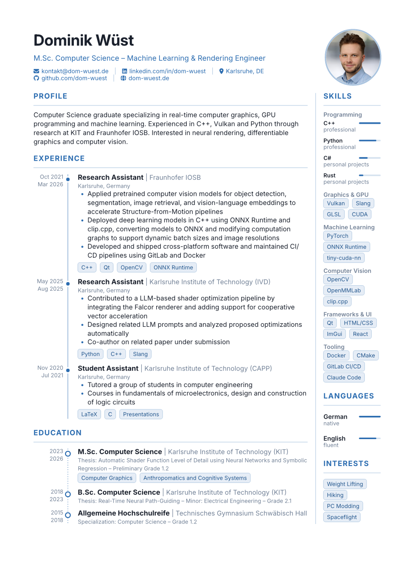
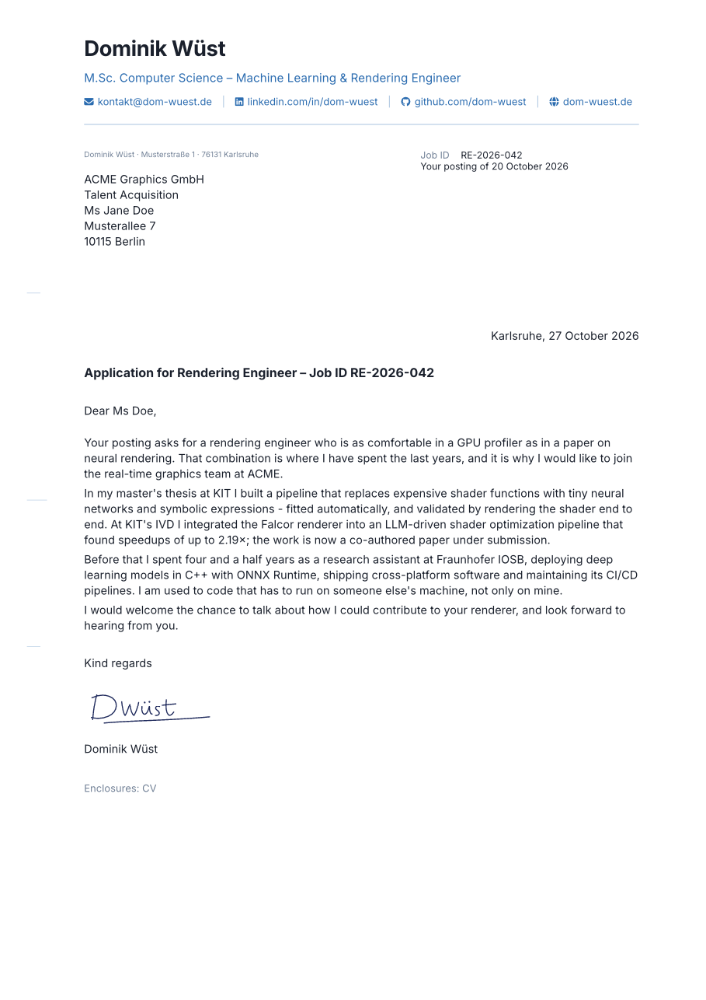
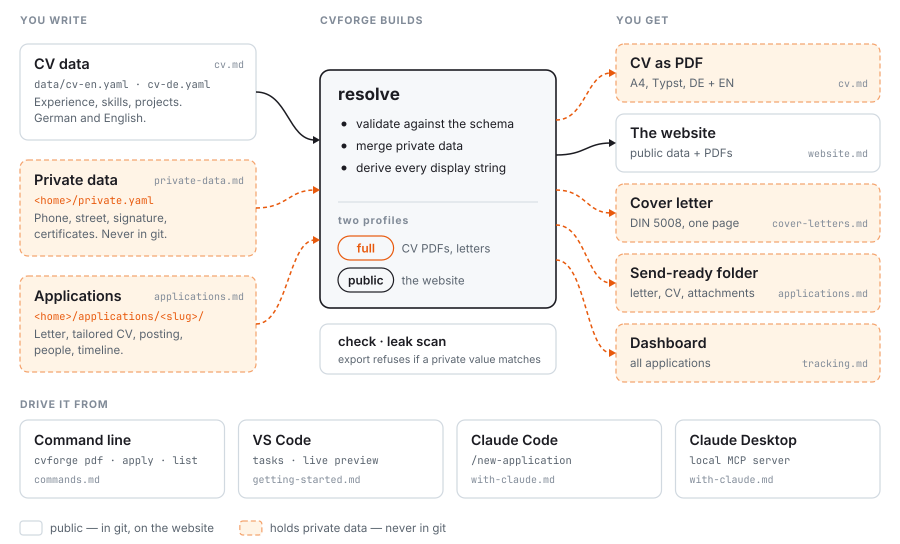

<h1 align="center">
  <picture>
    <source media="(prefers-color-scheme: dark)" srcset="assets/logo/cvforge-header-dark.svg">
    
  </picture>
</h1>

<p align="center">
  <b>One CV, written once as data.</b> From it: a typeset PDF, the CV on your
  website, and complete job applications - cover letter, matching CV and every
  attachment in one send-ready folder. In German and English, with your phone
  number and address kept out of git and off the website by construction.
</p>

<p align="center">
  <a href="docs/images/cv-en.pdf"></a>
  <a href="docs/images/letter-en.pdf"></a>
</p>
<p align="center"><sub>
  Left: the CV from <a href="data/cv-en.yaml"><code>data/cv-en.yaml</code></a> (<a href="docs/images/cv-en.pdf">PDF</a>, with its projects page).
  Right: a cover letter for an invented application from <a href="docs/demo/"><code>docs/demo/</code></a> (<a href="docs/images/letter-en.pdf">PDF</a>).
</sub></p>

---

## What it does

<picture>
  <source media="(prefers-color-scheme: dark)" srcset="docs/images/overview-dark.svg">
  
</picture>

| | |
|---|---|
| **[Write the CV](docs/cv.md)** | Two YAML files, English and German, validated as you type and previewed live. Typst sets them as an A4 PDF: a timeline, a sidebar, optional skill bars, an optional projects page with screenshots. |
| **[Keep private data private](docs/private-data.md)** | Phone, street, signature and certificates live in a *home* folder outside the repository - synced, never committed. A public build leaves them out, and a leak scan checks that it did. |
| **[Publish to the website](docs/website.md)** | `export` writes the public CV data and PDFs into a Hugo site - see it at [dom-wuest.de/about](https://dom-wuest.de/about/). |
| **[Write cover letters](docs/cover-letters.md)** | One YAML file per letter, laid out to DIN 5008 for a window envelope. Letterhead, address, signature and the enclosures line come from the data, so they never disagree with the CV. |
| **[Build applications](docs/applications.md)** | One folder per job: letter, optional tailored CV, posting, attachments. `apply` builds the numbered, named, send-ready set - and locks it once sent. |
| **[Track what happens next](docs/tracking.md)** | A dossier per application: the posting, the people, a timeline of calls and interviews. A dashboard shows all of it on one page, and `list --match` finds what you wrote for a similar job. |
| **[Work with Claude](docs/with-claude.md)** | A local MCP server lets Claude Desktop read past applications, draft and build new ones and log what happens - with every result scanned for private data. Or hand a brief to Claude Code's `/new-application`. |

## Quick start

You need [uv](https://docs.astral.sh/uv/) and [Typst](https://github.com/typst/typst).
Fonts are in the repository, so the output is identical on every machine.

```bash
uv run cvforge pdf --lang en        # -> out/cv-en.pdf
uv run cvforge check                # validate everything, report content warnings
```

Then make it yours: [Getting started](docs/getting-started.md) covers the
home folder, VS Code and the live preview.

## Documentation

| | |
|---|---|
| [Getting started](docs/getting-started.md) | Install, first build, the home folder, VS Code, live preview |
| [Writing the CV](docs/cv.md) | The YAML format, section by section, and the rules that bite |
| [Private data](docs/private-data.md) | The home, `private.yaml`, what is published and what is not |
| [Cover letters](docs/cover-letters.md) | `letter.yaml`, the layouts, signature, attachments |
| [Applications](docs/applications.md) | From `new` to the send-ready folder; a CV tailored to one job |
| [Tracking](docs/tracking.md) | Dossier, timeline, tracks, the dashboard, finding similar applications |
| [Publishing to the website](docs/website.md) | `export`, the public profile, the Hugo site |
| [Working with Claude](docs/with-claude.md) | Claude Desktop over MCP, Claude Code's `/new-application` |
| [Commands](docs/commands.md) | Every CLI command |
| [Troubleshooting](docs/troubleshooting.md) | Common errors and what they mean |

Working on the code or the templates rather than the content? Read
[CLAUDE.md](CLAUDE.md) - architecture, conventions, the private-data
guarantees, every design decision and the verification recipe.

## Licence

Code and templates: see [LICENSE](LICENSE). The bundled fonts are SIL OFL 1.1;
their licences are in [assets/fonts/](assets/fonts/). The CV content itself is
personal data, not licensed for reuse.
