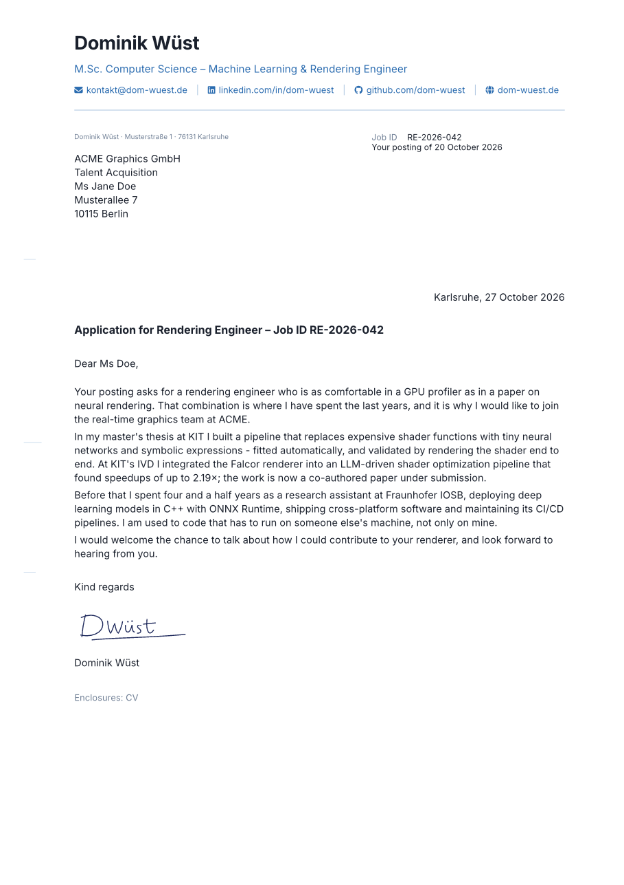

# Cover letters

[← README](../README.md) · [Getting started](getting-started.md) · [CV](cv.md) · [Private data](private-data.md) · **Cover letters** · [Applications](applications.md) · [Tracking](tracking.md) · [Website](website.md) · [Claude](with-claude.md) · [Commands](commands.md)

---

<a href="images/letter-en.pdf"></a>

A letter is one YAML file per application, `letter.yaml`. It holds only what
is specific to this job. Your name, tagline, contacts, address and signature
come from the CV and `private.yaml`, so the letterhead can never disagree with
the CV stapled behind it.

The letter is laid out to **DIN 5008 Form B**: the address sits in the window
of a DL envelope, fold and hole-punch marks are in the margin. The example on
the right is an invented application from [`docs/demo/`](demo/).

- [Building a letter](#building-a-letter)
- [letter.yaml](#letteryaml)
- [Layout](#layout)
- [Your signature](#your-signature)
- [Attachments](#attachments)

<br clear="right">

## Building a letter

A letter belongs to an application; [applications.md](applications.md)
covers creating one. Then:

```bash
uv run cvforge check                                   # validates letters too
uv run cvforge letter 2026-09-acme-rendering-engineer  # the draft -> out/letters/<slug>.pdf
```

`letter` warns when the result is more than one page. For a live preview while
you write, see [Live preview](getting-started.md#live-preview).

## letter.yaml

```yaml
meta:
  lang: de              # picks the CV the sender identity is read from
  slug: 2026-09-acme-rendering-engineer   # must match the directory
  date: null            # null = the day you build it
  layout: din           # din | compact - see Layout
  justify: false        # true = justified, hyphenated

recipient:
  company: "ACME GmbH"
  department: "Personalabteilung"   # optional
  person: "Frau Anna Beispiel"      # optional; printed in the address field
  salutation: "Sehr geehrte Frau Beispiel,"   # optional; see below
  street: "Musterallee 7"
  postal_code: "10115"
  city: "Berlin"
  country: null                     # only for a recipient abroad

job:
  title: "Rendering Engineer"
  reference: "REQ-2026-114"         # optional; info block + subject line
  reference_label: "Referenznummer" # optional; whatever THIS posting calls it
  source: "Ihre Anzeige auf StepStone vom 04.09.2026"   # optional; info block
  url: "https://..."                # optional; recorded, never printed

subject: null                       # optional override of the composed line
sender_contacts: [email, phone, github, website]   # optional; omit for all

body:                               # folded (>) paragraphs, in order
  - >
    …

attachments:                        # optional; see Attachments
  - masterzeugnis
closing: null                       # optional override
enclosures: null                    # optional; derived from attachments when unset
```

What is composed for you, and how to override it:

| Printed | Composed from | Override |
|---|---|---|
| Subject line | *Bewerbung als* / *Application for* + `job.title`, then the reference | `subject:` |
| Salutation | *Sehr geehrte Damen und Herren,* / *Dear Hiring Team,* | `recipient.salutation` |
| Info block | `job.reference` with its label, and `job.source` | - |
| Closing | *Mit freundlichen Grüßen* / *Kind regards* | `closing:` |
| Enclosures | The CV, then each attachment's label | `enclosures:` |
| Return line | Your name and the address from `private.yaml` | - |

**`salutation` is free text on purpose.** German forms of address need a gender
the data does not carry and should not guess, so a named salutation is written
out by hand.

**`reference_label`** - every career portal has its own word for the same
number: *Kennziffer*, *Referenznummer*, *Job-ID*, *Role ID*. Copy the posting's
own wording; quoting it back is the whole reason to print the number. Omit it
for *Kennziffer* / *Reference*.

**`sender_contacts`** - the letterhead has to fit above the address field, and
one contact row does while two do not. `location` is left out by default
because your postal address is already on the page, in the return line above
the recipient. If `cvforge letter` warns that the letter is two pages, trim
here or cut a paragraph.

## Layout

| `meta.layout` | |
|---|---|
| `din` *(default)* | DIN 5008 Form B: address field at 45 mm for a window envelope, fold marks at 87 and 192 mm, subject line at a fixed height. For a letter that may be printed. |
| `compact` | For a letter that only travels as a PDF: letterhead, address and text flow one after another, no fold marks. Frees about 30 mm for text. |

`meta.justify: true` sets the text justified and hyphenated in the letter's
language - so `meta.lang` must be right, or German compounds open wide gaps.

## Your signature

```yaml
# <home>/private.yaml
signature: "private/signature.png"
```

A transparent PNG around 800px wide, scanned from a black pen, works best; an
SVG works too. If the file is missing, the letter prints the typed name with
blank space above it - which is what you want if you intend to print and sign.
A scanned signature carries no extra legal weight on an emailed PDF anyway.

## Attachments

Certificates, transcripts and references are the same files for every
application, so they are declared once in `private.yaml` and picked per letter
by id. Put the files in `<home>/private/documents/`.

```yaml
# <home>/private.yaml
documents:
  # One file, one name - issued in German, sent as-is to everyone.
  - id: masterzeugnis
    file: "private/documents/scan_2023_04_11_0003.pdf"
    label: "Masterzeugnis"

  # One file, two names - a bilingual certificate; only the enclosures line changes.
  - id: bachelorzeugnis
    file: "private/documents/bachelorzeugnis.pdf"
    label:
      de: "Bachelorzeugnis"
      en: "Bachelor's Degree Certificate"

  # Two files, two names - issued separately per language.
  - id: transcript-master
    file:
      de: "private/documents/notenauszug_master_de.pdf"
      en: "private/documents/transcript_master_en.pdf"
    label:
      de: "Notenauszug (laufendes Masterstudium)"
      en: "Transcript of Records (Master, in progress)"
```

```yaml
# applications/<slug>/letter.yaml
attachments:
  - masterzeugnis
  - transcript-master
  - file: "attachments/portfolio.pdf"   # relative to this application
    label: "Arbeitsproben"              # for this job only
```

The name you *send* comes from `label`, not from whatever the scanner called
the file. `file` and `label` each take one string or one per language; a letter
picks the edition matching its own `lang`. If a document has per-language files
but not one for your language, the other is attached and the build says so.

The "Anlagen:" / "Enclosures:" line under your signature derives from this -
the CV, then each attachment's label - so it can never claim a document the
folder does not contain. Set `enclosures:` only to reword it.

Copying preserves digital signatures on the PDFs: the copy is byte-identical,
and a signature covers the file's content, not its name. Merging or
re-compressing would break them; nothing here does that.

How the attachments end up next to the letter is in
[applications.md](applications.md#the-send-ready-folder).
