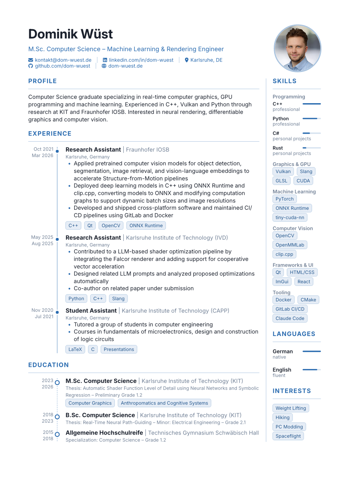
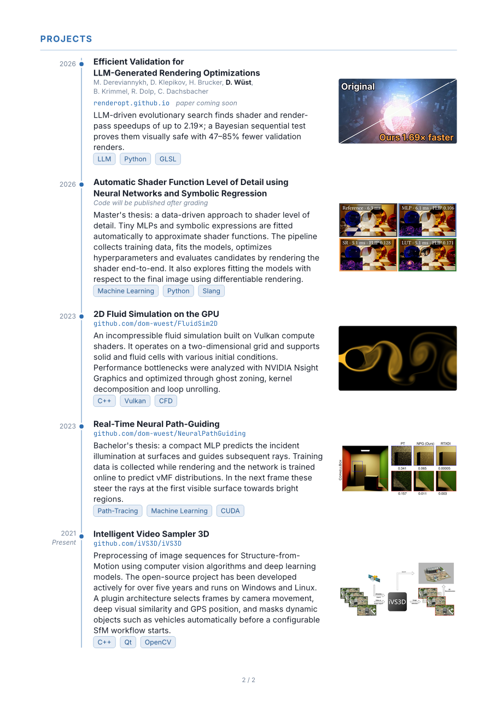

# Writing the CV

[← README](../README.md) · [Getting started](getting-started.md) · **CV** · [Private data](private-data.md) · [Cover letters](cover-letters.md) · [Applications](applications.md) · [Tracking](tracking.md) · [Website](website.md) · [Claude](with-claude.md) · [Commands](commands.md)

---

The CV is two YAML files, `data/cv-en.yaml` and `data/cv-de.yaml`, with
identical structure. They are the single source for the PDF, the website and
the letterhead of every cover letter.

<p align="center">
  <a href="images/cv-en.pdf"></a>
  <a href="images/cv-en.pdf"></a>
</p>
<p align="center"><sub>The English CV with <code>projects_layout: page</code>, built from <code>data/cv-en.yaml</code> with the public profile. <a href="images/cv-en.pdf">PDF</a></sub></p>

- [Building it](#building-it)
- [Three rules that bite](#three-rules-that-bite)
- [The sections](#the-sections): [`meta`](#meta) · [`contacts`](#contacts) · [`profile`](#profile) · [`experience`](#experience) · [`education`](#education) · [`projects`](#projects-optional) · [`skills`](#skills) · [`languages`](#languages) · [`interests`](#interests-optional)
- [Two languages](#two-languages)
- [Fitting on one page](#fitting-on-one-page)

## Building it

```bash
uv run cvforge check              # validate, and report content warnings
uv run cvforge pdf --lang en      # -> out/cv-en.pdf, prints the page count
uv run cvforge all                # every language
```

`schema/cv.schema.json` enforces the format, and VS Code shows completions and
errors as you type (see [getting-started.md](getting-started.md#vs-code)). For
a preview that updates while you type, see
[Live preview](getting-started.md#live-preview).

## Three rules that bite

**1. Dates are quoted strings**, `"YYYY"` or `"YYYY-MM"`. Precision follows
the length: `"2021-10"` renders as *Oct 2021*, `"2023"` as *2023*. Unquoted,
YAML turns a full `2021-10-01` into a date object, and the two look identical
in a diff. `end: null`, or no `end`, means ongoing → *Present* / *heute*.

**2. Quote anything YAML coerces.** `no`, `on`, `off`, `yes` become booleans.
`grade: 1.20` becomes the float `1.2`. Always `grade: "1.2"`.

**3. Store data, not presentation.**

```yaml
grade: "1.2"           # yes
grade_note: current

meta: "Current Grade 1.2"   # no
```

The renderers compose the display string. This is what lets the website show
the same facts in a different shape.

Entry order in the file is display order. Prose uses `>` (folded); reserve
`|` (literal) for text that needs real line breaks. `cvforge check` catches
all three mistakes.

## The sections

### `meta`

```yaml
meta:
  lang: en                                  # must match the filename
  name: "Dominik Wüst"
  tagline: "M.Sc. Computer Science – …"
  photo: "assets/avatar.jpg"                # repo-relative; null for none
  projects_layout: page                     # inline | page | omit
```

Some employers ask for a CV without a photograph: set `photo: null`, rebuild,
revert. The header collapses to full width and nothing else moves. For one
application only, do it in that application's [tailored CV](applications.md#a-cv-tailored-to-one-application).

### `contacts`

Display order is file order.

```yaml
contacts:
  - id: email               # join key with private.yaml, stable across languages
    icon: envelope          # Font Awesome name, used by BOTH renderers
    value: "kontakt@dom-wuest.de"
    url: "mailto:kontakt@dom-wuest.de"      # optional
  - id: github
    icon: github
    brand: true             # renders from the Font Awesome Brands font
    value: "github.com/dom-wuest"
    url: "https://github.com/dom-wuest"
```

| Key | |
|---|---|
| `id` | Required. Lowercase kebab-case. |
| `icon` | Required. Font Awesome icon name. |
| `value` | Required. The displayed text. |
| `url` | Optional. Makes it a link. |
| `brand` | `true` for `github`, `linkedin`, … (the Brands font has no solid variant). |
| `private` | `hidden` or `refine` - see [private-data.md](private-data.md#hidden-and-refine). |

**Write profile links as `linkedin.com/in/handle`, not just `handle`.** The
icon tells a human which platform it is, but the bare handle is not typeable
from a printed page, and ATS URL extraction matches on the domain. Drop the
`https://www.` - it is noise. Keep the full URL in `url` so the PDF stays
clickable.

### `profile`

One folded paragraph.

```yaml
profile: >
  Computer Science graduate specializing in real-time computer graphics …
```

### `experience`

```yaml
experience:
  - id: fraunhofer-iosb
    role: "Research Assistant"
    org: "Fraunhofer IOSB"
    location: "Karlsruhe, Germany"     # optional; becomes the small meta line
    start: "2021-10"
    end: "2026-03"                     # null or omitted = ongoing
    highlights:                        # optional; rendered as bullets
      - >
        Applied pretrained computer vision models …
    tags: ["C++", "Qt", "OpenCV"]      # optional; rendered as chips
```

To add an entry: copy an existing one, put it where it should appear (newest
first), give it a unique lowercase `id`, quote the dates, write one achievement
per highlight, then `uv run cvforge check`. Do the same in the other language.

### `education`

```yaml
education:
  - id: msc-kit
    degree: "M.Sc. Computer Science"
    org: "Karlsruhe Institute of Technology (KIT)"
    start: "2023"
    end: null
    thesis: >                          # title only - the "Thesis:" label is added
      Automatic Shader Function Level of Detail …
    minor: "Electrical Engineering"    # optional
    specialization: "Computer Science" # optional
    grade: "1.2"                       # optional, quoted
    grade_note: current                # current | preliminary | final | null
    tags: ["Computer Graphics"]
```

`thesis`, `specialization`, `minor` and `grade` are composed into one meta line
with ` – ` separators, skipping whatever is absent. `grade_note: current`
renders *Current Grade 1.2* (studies still running), `preliminary` renders
*Preliminary Grade 1.2* (degree obtained, final grade not yet published), and
`final` renders *Grade 1.2*.

### `projects` *(optional)*

Where projects appear is a single switch, `meta.projects_layout`:

| | |
|---|---|
| `inline` *(default)* | In the main column with the other sections, as an ordinary timeline. |
| `page` | On its own full-width page after the CV, with room for a screenshot beside each entry. |
| `omit` | Left out entirely. |

It is `omit`, **not** `off` - YAML 1.1 reads an unquoted `off` as `false`.
`image` is only read by the `page` layout.

```yaml
projects:
  - id: path-tracer
    name: "Real-Time Path Tracer"
    role: "Solo project"               # optional; becomes the meta line
    summary: >                         # optional
      A Vulkan path tracer with ReSTIR direct lighting.
    start: "2024-05"
    end: null
    url: "https://github.com/dom-wuest/example"    # optional
    url_label: "github.com/dom-wuest/example"      # optional; derived from url
    url_note: "Code will be published after grading" # optional; replaces a missing url, or follows it
    authors: ["A. Author", { name: "D. Wüst", me: true, break_after: true }] # optional; `me` is bold, `break_after` wraps
    image: "assets/projects/path-tracer.jpg"       # optional; `page` layout only
    highlights: ["Wavefront path tracing …"]       # optional
    tags: ["Vulkan", "Slang"]
```

Images live in `assets/projects/`; `cvforge check` warns if one is missing,
because a missing image is a hard Typst error.

### `skills`

A **list of groups**, not a mapping - mappings do not guarantee order, and
order is meaningful here.

```yaml
skills:
  - group: "Programming"
    items:
      - { name: "C++", rating: 5, note: "professional" }
      - { name: "Rust", rating: 2, note: "personal projects" }
  - group: "Graphics & GPU"
    items: ["Vulkan", "Slang", "GLSL", "CUDA"]   # bare names -> chips
```

An item is either a **bare name**, rendered as a chip, or a **mapping** with an
optional `rating` (1–5, draws a bar) and an optional `note` (a short muted line
beneath). Either promotes the item onto a full-width row of its own.

**Use ratings sparingly.** A bar against every skill turns into wallpaper, and
it invites the reader to ask what the missing two fifths are - a question you
gain nothing by raising. `note` is usually the more valuable of the two: a bar
says *how much*, a note says *in what context*.

Skills render directly above the spoken `languages` section, so **do not name
a group after it** - in German the two would be the identical word *Sprachen*.
Use *Programming* / *Programmierung*.

### `languages`

`level` is free text, already in the file's own language.

```yaml
languages:
  - name: "German"
    level: "native"
    rating: 5 # optional, 1-5
```

### `interests` *(optional)*

```yaml
interests: ["Weight Lifting", "Hiking", "PC Modding", "Spaceflight"]
```

Keep these **non-technical**. Rendering and AI are already the tagline, the
profile, the skills and every project. The value of this section is the part
the rest of the CV cannot show.

## Two languages

The two files are independent, with identical structure. Nothing forces them
to agree; keep them in step by hand. Section headings, *Present* / *heute* and
month names are not in the data - CVForge supplies them per language.

To add a language, add a block to `src/cvforge/i18n.py` and a
`data/cv-<lang>.yaml`.

## Fitting on one page

With `projects_layout: omit` the CV is one page; with `page` it is two, the
second being the projects page. `cvforge pdf` prints the page count - **check
German first**, it runs longer. If a CV overflows, shorten the content, or see
[CLAUDE.md](../CLAUDE.md#fitting-on-one-page) for the spacing knobs in the
template.
