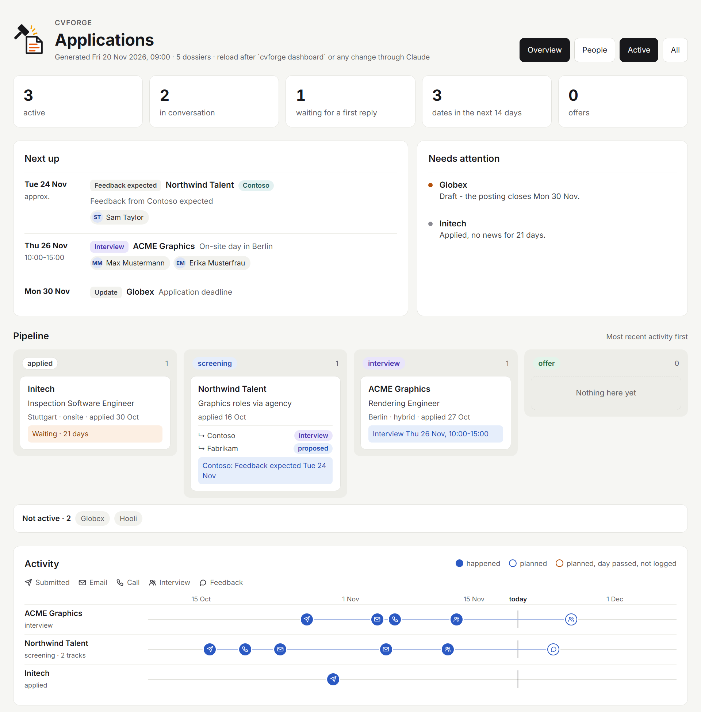
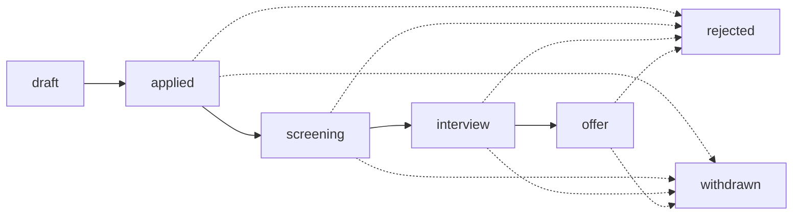
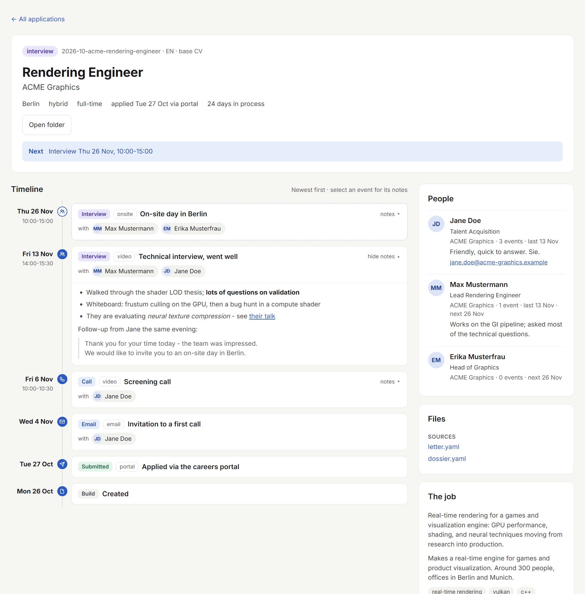

# Tracking applications

[← README](../README.md) · [Getting started](getting-started.md) · [CV](cv.md) · [Private data](private-data.md) · [Cover letters](cover-letters.md) · [Applications](applications.md) · **Tracking** · [Website](website.md) · [Claude](with-claude.md) · [Commands](commands.md)

---

Three weeks after you apply, the posting has been taken down and you are in
the interview. The dossier is where the facts still are: what the job was,
who you spoke to, what was said, what is coming up. The dashboard shows all of
it on one page.

<picture>
  <source media="(prefers-color-scheme: dark)" srcset="images/dashboard-dark.png">
  
</picture>
<p align="center"><sub>The dashboard, filled with the invented applications in <a href="demo/"><code>docs/demo/</code></a>.</sub></p>

- [The dossier](#the-dossier)
- [Status](#status)
- [The timeline](#the-timeline)
- [Tracks](#tracks)
- [The dashboard](#the-dashboard)
- [Finding similar applications](#finding-similar-applications)

## The dossier

Every application has a `dossier.yaml` next to its letter. Nothing renders
from it; it exists for two moments - the interview, and the next time a job
like this one comes up.

```yaml
summary: >                      # what the job is - the anchor for similarity
  Real-time rendering for a games engine: GPU performance, shading, neural techniques.
keywords: [real-time rendering, vulkan, c++, shaders]

company: { name: "ACME Graphics", about: "Makes a real-time engine. Berlin." }
role: { location: "Berlin", work_model: hybrid, employment: full-time }
applied: "2026-10-27"

posting:
  url: "https://…"
  fetched: "2026-10-20"
  archive: posting/posting.pdf  # relative to the application
  deadline: null
  notes: what they actually ask for, in your own words

approach:                       # how you pitched yourself - worth reusing
  based_on: null                # the earlier application this one started from
  angle: "Thesis + the shader optimization paper"
  cv: ["Projects page included"]
  gaps: ["No shipped game title"]

contacts:
  - { name: Jane Doe, role: Talent Acquisition, email: jane.doe@example.com, notes: "Sie." }

status: interview
timeline: [ … ]                 # see below
```

The full set of fields, with comments, is in
[`applications/_template/dossier.example.yaml`](../applications/_template/dossier.example.yaml),
and `schema/dossier.schema.json` gives completions in VS Code. `cvforge check`
warns about what makes a dossier useless later: no summary or keywords, a
status that says sent with no `applied` date, an archived posting that is not
there, a participant who is not in `contacts`.

## Status



`status` is the relationship with the company you applied to. Once it is past
`draft`, or `applied:` is set, [`send/` is locked](applications.md#once-it-is-sent).

## The timeline

One entry per event, oldest first:

```yaml
timeline:
  - date: "2026-11-13"
    time: "14:00-15:30"
    kind: interview        # build | submitted | email | call | interview | assessment
                           # | trial-day | feedback | offer | rejection | other
    channel: video         # phone | video | email | onsite | portal | post
    with: [Max Mustermann, Jane Doe]   # by contact name
    event: Technical interview, went well
    notes: |
      - Walked through the thesis; lots of questions on validation
      - Next: on-site day
    files: [recv/questionnaire.pdf]    # relative to the application
```

Something that has not happened yet - an interview, a deadline, a promised
answer - gets `planned: true` (and `approx: true` if the date is a guess).
When it happens, **update that entry** instead of adding a second one.

### Formatting notes

Notes - and `summary`, `company.about`, `approach` and portal answers - are
shown with a subset of Markdown:

| Write | Shows |
|---|---|
| `**bold**`, `*italic*` (or `__bold__`, `_italic_`) | **bold**, *italic* |
| `` `RE-2026-042` `` | `RE-2026-042` |
| `https://…`, `jane@example.com`, `[the posting](https://…)` | links - http, https and mailto only |
| `- item`, `1. item` | a list, a numbered list; an indented line continues the item |
| `> Thank you for …` | a quote that keeps its line breaks - for pasting an email word for word |

Anything else - headings, tables, images, HTML - is shown as the plain text you
wrote, and so is a marker that does not pair up. `5*3*2`, `*.pdf` and
`posting_v2_final.pdf` stay as they are.

Write notes as a literal block, `notes: |`. A folded block, `notes: >`, joins
its lines, so a list or a quote in it becomes one run-on paragraph;
`cvforge check` warns about that, and about headings or tables the dashboard
will not format. On a single line, YAML itself gets in the way: a value that
starts with `*`, `[` or `` ` `` needs quotes, and an unquoted ` #` starts a
comment that silently cuts the rest off. Claude Desktop knows all of this and
writes notes the way the dashboard shows them.

One fact, one place: what was said at an event goes in that event's `notes`;
facts about a person (Du or Sie, background, how to reach them) in their
contact `notes`; what concerns the application as a whole in the dossier's
`notes`.

## Tracks

An application to a placement agency is several processes at once: the agency
proposes you to one client, then another, each with its own interviews and
outcome. Tracks keep them apart:

```yaml
tracks:
  - { id: contoso,  company: Contoso,  title: Engine Programmer,   status: interview }
  - { id: fabrikam, company: Fabrikam, title: Simulation Engineer, status: proposed }
```

Events name a track with `track: contoso`. A contact who works for the client
rather than the agency gets `org: Contoso`. The same mechanism covers a
company that moves you from the posting you applied to onto another one
(`status: moved`).

## The dashboard

```bash
uv run cvforge dashboard --open      # writes <home>/dashboard.html
```

One page in the browser, nothing to install or serve:

- **Overview** - counters, what is coming up in the next three weeks, what
  needs attention (a draft whose posting has a deadline, an application with no
  news for ten days, a planned event whose day has passed), the pipeline by status,
  and an activity strip across all applications.
- **Per application** - status and next step, the timeline with participants
  and expandable notes, the people with their activity, links to the files.
- **People** - everyone across all applications.

<picture>
  <source media="(prefers-color-scheme: dark)" srcset="images/dashboard-app-dark.png">
  
</picture>

It follows your system's light or dark theme. The [Claude Desktop
server](with-claude.md) rewrites it after every change; otherwise run the command
again and reload. It contains your contacts' details, so it stays in the home
and is never published.

## Finding similar applications

```bash
uv run cvforge list                        # every application, newest first
uv run cvforge list --match vulkan shader  # those whose keywords or summary match
uv run cvforge list --status applied interview
```

`--match` filters but does not re-rank: the CV and the letters get better with
every application, so the most recent match is usually the best starting
point. Start a new application from it with
`cvforge new <slug> --from <earlier-slug>`.
