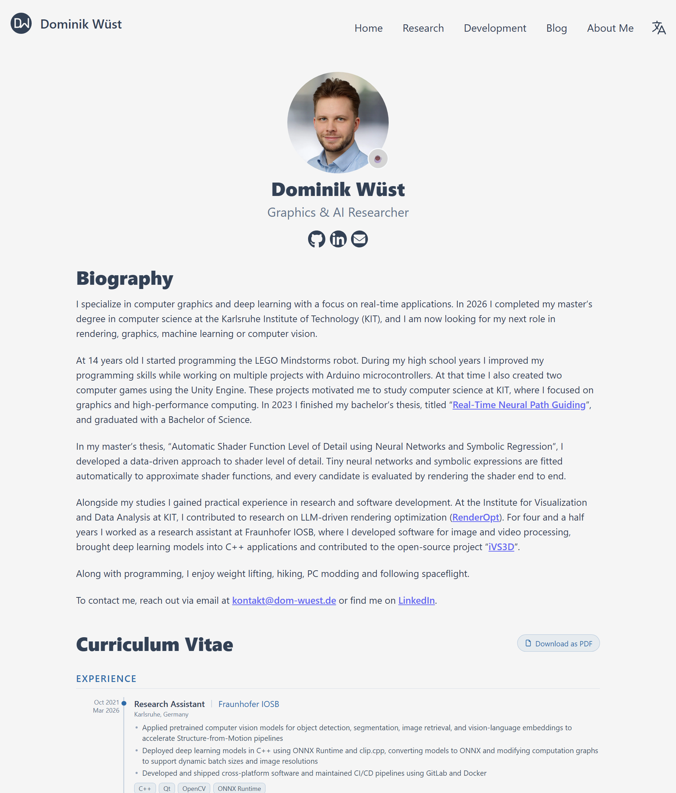

# Publishing to the website

[← README](../README.md) · [Getting started](getting-started.md) · [CV](cv.md) · [Private data](private-data.md) · [Cover letters](cover-letters.md) · [Applications](applications.md) · [Tracking](tracking.md) · **Website** · [Claude](with-claude.md) · [Commands](commands.md)

---

The CV on [dom-wuest.de/about](https://dom-wuest.de/about/) is the same data
as the PDF. CVForge exports it into the
[Portfolio](https://github.com/dom-wuest/Portfolio) repository, a Hugo site,
which renders it in its own layout.

<a href="https://dom-wuest.de/about/"></a>

## Exporting

```bash
uv run cvforge check
uv run cvforge export --to ../Website/Portfolio
```

`export` refuses to run unless the target has `config/_default/hugo.yaml`. It
then:

1. builds both languages with the **public** profile - `private.yaml` ignored,
   `private: hidden` contacts dropped (see [private-data.md](private-data.md#hidden-and-refine));
2. re-reads what it built and refuses if it is not marked public;
3. writes the data to `data/cv/en.json` and `data/cv/de.json` in the site;
4. builds public PDFs into `static/files/` for the site's download button -
   never into `out/`, so the PDF you send with applications is not replaced;
5. scans every file it wrote for every value in `private.yaml`, and ends with
   `clean`.

Then commit both repositories and **cut a release in the website repository** -
it deploys on `release: published`, not on push.

## Who owns what

This repository owns the content; the Portfolio repository owns the look.
Changing how the CV appears on the site is done there
(`layouts/partials/cv.html`, `assets/css/custom.css`) - nothing here changes
and nothing needs re-exporting. The site's build also refuses CV data that is
not marked public, so the check holds on both sides of the repository
boundary.

## Why a copy, not automation

This repository was private, and anything that pulls from it - a submodule, a
CI fetch - needs a token in the public repository's secrets, breaks for forks,
and makes a public build depend on another repository staying reachable. The
site deploys only on a published release anyway, so automating the copy would
not save a step.

## Your own site

The exported JSON is plain data: every section, already resolved - dates
formatted, labels in the right language, contacts filtered for the public. Any
static site generator that reads JSON can render it; the Portfolio repository
is one example of a template for it.
